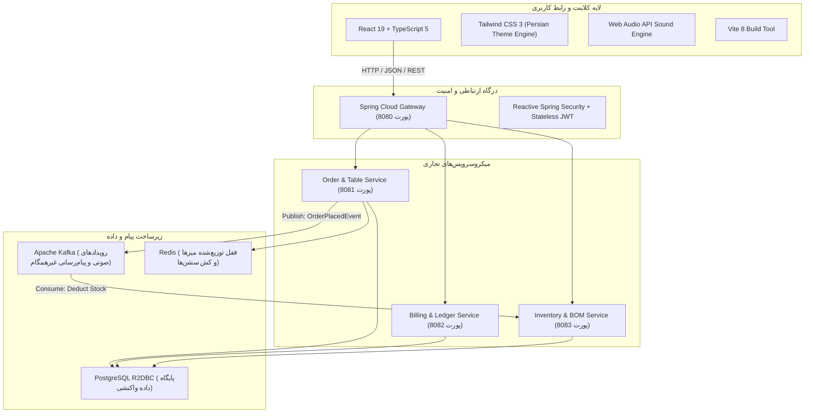
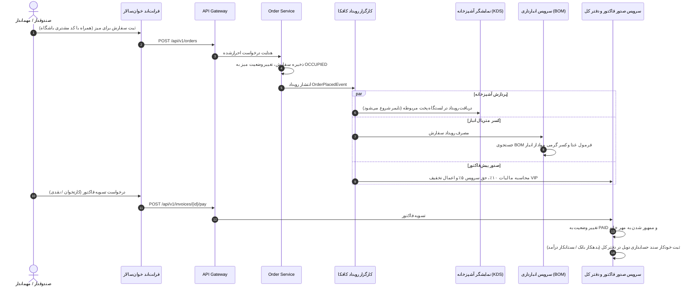

# مستندات جامع فنی و راهنمای سامانه ERP و POS خوان‌سالار (Khansalar)

> **سامانه جامع، واکنشی (Reactive) و غیرهمگام مدیریت رستوران، کافه، سفارش‌گیری، انبارداری هوشمند (BOM)، باشگاه مشتریان (CRM) و حسابداری دوطرفه دفتر کل**

---

## ۱. نمای کلی پروژه و هویت سازمانی (Executive Summary)

سامانه **«خوان‌سالار»** با هدف ایجاد بستری مدرن، قدرتمند و متکی بر معماری پیشرفته ریزخدمات (Microservices Architecture) برای رستوران‌ها، هتل‌ها و کافه‌های زنجیره‌ای سطح اول طراحی شده است. 

این سیستم دو لایه بنیادین را به شکلی پیوسته به هم پیوند می‌زند:
1. **معماری فنی فوق سریع سازمانی:** مبتنی بر پردازش واکنشی (Non-blocking I/O) با جاوا ۲۱، Spring WebFlux، صف رویدادهای توزیع‌شده Apache Kafka، حافظه پرسرعت Redis و پایگاه داده رابطه‌ای غیرهمگام PostgreSQL R2DBC.
2. **تجربه کاربری و هویت بصری فاخر ایرانی:** بهره‌گیری از هنر اصیل تذهیب و نقوش سنتی (گره‌چینی اسلیمی، شمسه زرین، گل شاه‌عباسی، بته‌جقه، مهر خاتم سلطنتی)، پشتیبانی بومی از تقویم و ساعات جلالی، کلیدهای میانبر سریع صندوقداری (F1 تا F7) و پالت‌های رنگی الهام‌گرفته از لاجورد شاه‌عباسی، فیروزه نیشابور و یاقوت انار.

---

## ۲. پشته فناوری (Technology Stack)



### بخش بک‌اند (Backend Architecture):
* **زبان پایه:** Java 21 (LTS) با بهره‌گیری از قابلیت‌های نوین JVM
* **فریم‌ورک هسته:** Spring Boot 3.3.4
* **هسته پردازشی غیرهمگام:** Spring WebFlux + Project Reactor (`Mono` / `Flux`)
* **ارتباط با پایگاه داده:** Spring Data R2DBC (بدون بلاک شدن تِردها در لایه دیتابیس)
* **پایگاه داده رابطه‌ای:** PostgreSQL 16
* **گذرگاه پیام توزیع‌شده:** Apache Kafka (حالت KRaft)
* **کش و قفل‌های توزیع‌شده:** Redis Reactive (Lettuce Driver)
* **امنیت و احراز هویت:** Spring Security Reactive با توکن‌های JWT و نقش‌های کاربری تفکیک‌شده

### بخش فرانت‌اند (Frontend Architecture):
* **کتابخانه رابط کاربری:** React 19 + TypeScript (تنظیمات سخت‌گیرانه `verbatimModuleSyntax` و `noUnusedLocals`)
* **ابزار ساخت:** Vite 8
* **استایل‌دهی و دیزاین سیستم:** Tailwind CSS شخصی‌سازی شده با رنگ‌مایه‌های اصیل ایرانی:
  - لاجورد عمیق شاه‌عباسی: `#050e1f` و `#0a1a3b`
  - طلایی کالیگرافی و تذهیب: `#e5b869`
  - فیروزه‌ای نیشابوری: `#00c8b3`
  - یاقوت اناری: `#e63946`
* **افکت‌های صوتی تعاملی:** موتور داخلی Web Audio API (تولید صدای فرکانسی دخل، زنگ هشدار آشپزخانه، افزودن غذا)
* **فیدبک‌های تصویری:** Canvas Confetti هنگام تسویه فاکتور و بستن دخل روزانه
* **چاپ حرارتی:** پشتیبانی اختصاصی از فیش‌های استاندارد ۸۰ میلی‌متری و کاغذ A4 با فرمت‌بندی رسمی

---

## ۳. ساختار ماژول‌ها و پروژه‌ها (Repository Structure)

```
c:\Users\Asus\Desktop\Programming\Java\khansalar\
│
├── docker-compose.yml              # کانتینرهای زیرساختی PostgreSQL, Redis, Kafka
├── README.md                       # راهنمای اجمالی پروژه
├── DOCUMENTATION.md                # مستندات کامل فنی (این سند)
│
├── khansalar-backend/              # پروژه چندماژولی Maven برای بک‌اند
│   ├── pom.xml                     # فایل ریشه مدیریت وابستگی‌های جاوا ۲۱
│   │
│   ├── khansalar-common/           # ماژول کتابخانه اشتراکی
│   │   ├── domain/enums/           # مقادیر شمارشی (OrderStatus, KitchenStation, CustomerTier, ...)
│   │   ├── dto/                    # آبجکت‌های انتقال داده مشترک
│   │   └── events/                 # رکوردهای رویدادهای کافکا (OrderPlacedEvent, ...)
│   │
│   ├── khansalar-gateway/          # دروازه ورودی، پورت 8080
│   │   ├── config/                 # پیکربندی روت‌های واکنشی و CORS
│   │   └── security/               # مدیریت توکن‌های JWT و احراز هویت کاربران
│   │
│   ├── khansalar-order-service/    # سرویس سفارشات و سالن، پورت 8081
│   │   ├── controller/             # کنترلرهای REST برای میزها، سفارشات، منو و مشتریان
│   │   ├── service/                # منطق تجاری سفارش‌گیری، میزها، صف KDS سرآشپز
│   │   ├── repository/             # اینترفیس‌های R2DBC برای پرس‌وجوی داده‌ها
│   │   └── kafka/                  # انتشار رویدادهای OrderPlacedEvent در کافکا
│   │
│   ├── khansalar-billing-service/  # سرویس مالی و حسابداری، پورت 8082
│   │   ├── controller/             # روت‌های صدور فاکتور، پرداخت و اسناد دفتر کل
│   │   ├── service/                # محاسبات مالیات بر ارزش افزوده، حق سرویس، تخفیفات و بستن روزانه
│   │   └── model/                  # انتیتی‌های فاکتور و اسناد حسابداری دوبل (Debit/Credit)
│   │
│   └── khansalar-inventory-service/# سرویس انبارداری و فرمولاسیون (BOM)، پورت 8083
│       ├── controller/             # کنترلرهای موجودی کالا، ثبت بار و آنالیز فودکاست
│       ├── service/                # کسر خودکار متریال مصرفی و بررسی نقطه سفارش
│       └── kafka/                  # شنونده رویداد سفارشات برای کاهش متریال انبار
│
└── khansalar-frontend/             # پنل کاربری React 19 + TypeScript
    ├── src/
    │   ├── components/             # کامپوننت‌های فرانت‌اند
    │   │   ├── Navbar.tsx          # هدر سیستم، انتخاب تب‌ها، کلیدهای میانبر و ساعت
    │   │   ├── TableFloorPlan.tsx  # نقشه تعاملی سالن، جایگاه‌ها و وضعیت صندلی‌ها (F1)
    │   │   ├── OrderPosView.tsx    # صندوق و ثبت سفارش سریع با CRM (F2)
    │   │   ├── InvoiceView.tsx     # نمایش فاکتور رسمی، چاپ، دانگ‌شمار و پرداخت (F3)
    │   │   ├── KitchenDisplayView.tsx # نمایشگر ایستگاه‌های آشپزخانه KDS (F4)
    │   │   ├── InventoryView.tsx   # انبارداری، موجودی مواد اولیه و فرمول ساخت BOM (F5)
    │   │   ├── CustomersView.tsx   # باشگاه مشتریان، سطح‌بندی و کیف پول (F6)
    │   │   ├── AccountingLedgerView.tsx # دفتر کل اسناد حسابداری و بستن روزانه (F7)
    │   │   ├── PersianSymbols.tsx  # آیکون‌های وکتور اختصاصی ایرانی (بته‌جقه، شاه‌عباسی و ...)
    │   │   ├── GirihOrnament.tsx   # نقوش گره‌چینی، شمسه و کتیبه‌های اسلیمی
    │   │   └── ItemModifierModal.tsx # مدال شخصی‌سازی خوراک‌ها و افزودنی‌ها
    │   ├── services/api.ts         # کلاینت ارتباطی API همراه با لایه پایدار لوکال استوریج
    │   ├── types/index.ts          # تایپ‌های جامع TypeScript برای تمام موجودیت‌های ERP
    │   ├── utils/persianUtils.ts   # توابع فرمت‌بندی اعداد، ریال، تومان و تاریخ خورشیدی
    │   ├── utils/soundEffects.ts   # سینتی‌سایزر صوتی تعبیه شده با Web Audio API
    │   ├── App.tsx                 # کنترلر اصلی و سیم‌کشی فرانت‌اند
    │   └── index.css               # انیمیشن‌ها، استایل‌های چاپ حرارتی و گره‌چینی
    ├── package.json
    └── tailwind.config.js
```

---

## ۴. چرخه حیات سفارش و رویدادهای داده‌ای (Order Life Cycle & Event Flow)



---

## ۵. تشریح ماژول‌های هفت‌گانه ERP

### ۱. نقشه سالن و پایش میزها (`TableFloorPlan` - کلید میانبر: F1)
- **مدیریت بخش‌های سالن:** فیلتربندی سریع بین شاه‌نشین سلطنتی (VIP)، تالار حافظ و سعدی، حیاط سنتی و آب‌نما.
- **شاخص‌های زنده سالن:** محاسبه در لحظه کل ظرفیت، تعداد میزهای خالی، میزهای در حال پذیرایی و جمع مبالغ باز.
- **تایمر مدت حضور مهمان:** پایش زمان دقیق نشستن مشتریان برای ارتقای نرخ گردش میزها.
- **سیستم فراخوان مهماندار:** کلید زنگ اضطراری برای هر میز با اعلان صوتی و تصویری.

### ۲. صندوق و ثبت سفارش سریع (`OrderPosView` - کلید میانبر: F2)
- **منوی تصویری و دسته‌بندی شده:** جستجوی بلادرنگ، دسته‌بندی کباب‌ها، خوراک‌های اصیل، شربت‌ها و دسرها.
- **مدال سفارشی‌سازی پخت (`ItemModifierModal`):** امکان انتخاب متریال اضافه (کره محلی، ته دیگ زعفرانی، برنج اضافه) و ثبت یادداشت‌های ویژه مهمان.
- **یکپارچگی با باشگاه مشتریان:** انتخاب مشتری عضو و محاسبه آنی تخفیف‌های ویژه (۵٪ برای طلایی و ۱۰٪ برای پلاتین).
- **محاسبات استاندارد مالی:** تفکیک ناخالص، تخفیف، ارزش افزوده (۱۰٪) و حق سرویس (۵٪).

### ۳. فاکتور رسمی، چاپ و دانگ‌شمار (`InvoiceView` - کلید میانبر: F3)
- **طراحی فیش اصیل ایرانی:** حاشیه‌بندی اسلیمی، نمایش شماره شناسه مالیاتی یکتا و مهر رسمی خاتم خوان‌سالار.
- **ماشین‌حساب دانگ‌شمار (Split Bill):** محاسبه سهم هر فرد در میزهای گروهی و دوستانه با نمایش ریال و تومان.
- **گزینه‌های چندگانه پرداخت:** پوز بانکی، نقدی صندوق، یا پرداخت آنلاین و کارت‌به‌کارت.
- **خروجی چاپ استاندارد (F9):** فرمت‌بندی واکنش‌گرا برای پرینترهای حرارتی ۸۰ میلی‌متری و نسخه‌های رسمی A4.

### ۴. نمایشگر KDS سرآشپز و بارتندر (`KitchenDisplayView` - کلید میانبر: F4)
- **تفکیک ایستگاه‌های کاری:** منقل و کباب‌پزی، آشپزخانه دیزی و خوراک گرم، شربت‌خانه سنتی، قنادی و دسر، اردور و مزه.
- **کنترل وضعیت چندمرحله‌ای هر قلم:** دریافـت شده (`RECEIVED`) ← در حال پخت (`PREPARING`) ← آماده سـرو (`READY`) ← تحویل شده (`SERVED`).
- **سامانه هشدار زمانی:** تغییر رنگ کارت به زرد (بیش از ۱۰ دقیقه) و قرمز چشمک‌زن (بیش از ۱۵ دقیقه).
- **اعلان صوتی اختصاصی:** پخش صدای آلرت متالیک هنگام آماده شدن سفارش جهت فراخوان مهماندار.

### ۵. انبارداری هوشمند و آنالیز فرمول ساخت BOM (`InventoryView` - کلید میانبر: F5)
- **پایش مقادیر موجودی:** نمایش مقدار، واحد اندازه‌گیری، بهای واحد خرید و حد آستانه بحرانی سفارش.
- **آنالیز فود کاست (Food Cost):** محاسبه قیمت تمام‌شده متریال مصرفی هر پرس غذا در مقایسه با نرخ فروش و محاسبه حاشیه سود خالص.
- **ثبت مکانیزه فاکتور خرید (Restock):** مدال ثبت ورود بار جدید از بنکداران و افزایش خودکار موجودی انبار.
- **هشدار دیداری کسری انبار:** نمایش بنر خطر هنگام رسیدن موجودی به زیر حد مجاز تعیین‌شده.

### ۶. باشگاه مشتریان و مدیریت وفاداری (`CustomersView` - کلید میانبر: F6)
- **سطح‌بندی چهارگانه اعضا:** برنزی، سیمین، زرین و پلاتین سلطنتی.
- **پروفایل و ذائقه مهمان:** ذخیره ترجیحات ویژه، میز مورد علاقه، تاریخ تولد (جهت آفرها) و تاریخچه مراجعات.
- **امتیازدهی مکانیزه:** تبدیل خودکار مبالغ خرید به امتیازات وفاداری و ذخیره در کیف پول اعتباری.

### ۷. دفتر کل و اسناد دوبل مالی (`AccountingLedgerView` - کلید میانبر: F7)
- **سیستم حسابداری دوطرفه (Double-Entry):** ثبت اسناد با ستون‌های متوازن بدهکار (Debit) و بستانکار (Credit).
- **شاخص‌های کلیدی تراز:** موجودی نقد صندوقدار، مانده حساب‌های بانکی پوزها، بدهی مالیات ارزش افزوده و سود ناخالص.
- **بستن روزانه صندوق (Daily Closing):** قابلیت بستن حساب‌های روز با یک کلیک، قفل گردش مالی، تولید گزارش تراز و درج مهر رسمی خاتم با انیمیشن جشن مالی.

---

## ۶. راهنمای راه‌اندازی و اجرای پروژه (Installation & Setup)

### پیش‌نیازها:
- **Java JDK 21** یا بالاتر (تنظیم در متغیر محیطی `JAVA_HOME`)
- **Apache Maven 3.9+**
- **Node.js 20+** و **npm**
- **Docker** و **Docker Compose** (برای اجرای زیرساخت دیتابیس و کافکا)

### مرحله اول: اجرای کانتینرهای زیرساختی
در مسیر اصلی پروژه دستور زیر را در ترمینال اجرا کنید:
```bash
docker-compose up -d
```
با این دستور سرویس‌های زیر اجرا می‌شوند:
- **PostgreSQL R2DBC:** پورت `5432` (کاربر: `khansalar` / رمز: `khansalar_secret`)
- **Redis:** پورت `6379`
- **Apache Kafka:** پورت `9092`

### مرحله دوم: کامپایل و اجرای سرویس‌های بک‌اند
```bash
cd khansalar-backend
mvn clean compile
```

برای اجرای مجزای سرویس‌ها:
1. **دروازه ورودی (Gateway - پورت 8080):**
   ```bash
   cd khansalar-gateway
   mvn spring-boot:run
   ```
2. **سرویس سفارشات (Order Service - پورت 8081):**
   ```bash
   cd khansalar-order-service
   mvn spring-boot:run
   ```
3. **سرویس مالی و حسابداری (Billing Service - پورت 8082):**
   ```bash
   cd khansalar-billing-service
   mvn spring-boot:run
   ```
4. **سرویس انبارداری (Inventory Service - پورت 8083):**
   ```bash
   cd khansalar-inventory-service
   mvn spring-boot:run
   ```

### مرحله سوم: اجرای فرانت‌اند
در یک پنجره ترمینال مجزا:
```bash
cd khansalar-frontend
npm install
npm run dev
```
سامانه بلافاصله روی آدرس زیر در دسترس خواهد بود:
```
http://localhost:5173
```

---

## ۷. فهرست حساب‌های کاربری پیش‌فرض سیستم

| ردیف | نام کاربری | کلمه عبور | سطح دسترسی و نقش سازمانی |
|:---:|:---:|:---:|:---|
| ۱ | `admin` | `admin123` | **مدیر ارشد خوان‌سالار:** دسترسی کامل به کلیه گزارشات، دفتر کل، انبارداری و بستن روزانه |
| ۲ | `cashier` | `123456` | **صندوقدار سالن:** ثبت سفارش، صدور فاکتور و تسویه حساب میزها |
| ۳ | `waiter` | `123456` | **مهماندار سالن:** مشاهده نقشه میزها و ثبت سفارشات اولیه |
| ۴ | `chef` | `123456` | **سرآشپز:** دسترسی به KDS، تغییر وضعیت پخت اقلام منو |
| ۵ | `accountant` | `123456` | **مدیر مالی:** نظارت بر تراز دفتر کل و گزارشات مالیاتی سامانه مودیان |

---

## ۸. جدول راهنمای کلیدهای میانبر سریع (Hotkeys)

| کلید میانبر | ماژول مرتبط | شرح عملکرد |
|:---:|:---:|:---|
| **F1** | نقشه سالن | مشاهده وضعیت صندلی‌ها، مناطق و مبالغ باز میزها |
| **F2** | صندوق و سفارش | ورود مستقیم به صفحه سفارش‌گیری و سبد فیش |
| **F3** | فاکتورها | مدیریت صورتحساب‌های معوق و تسویه میزها |
| **F4** | KDS آشپزخانه | مانیتورینگ خط پخت، ایستگاه‌های کباب، بار و دسر |
| **F5** | انبارداری | بررسی موجودی بحرانی کالاها و فرمولاسیون BOM |
| **F6** | باشگاه مشتریان | پروفایل مشتریان وفادار و ثبت عضویت جدید |
| **F7** | دفتر کل | بررسی تراز اسناد دوبل و بستن روزانه صندوق |
| **F9** | پرینت فیش | صدور دستور چاپ مستقیم فاکتور برای چاپگر حرارتی |
