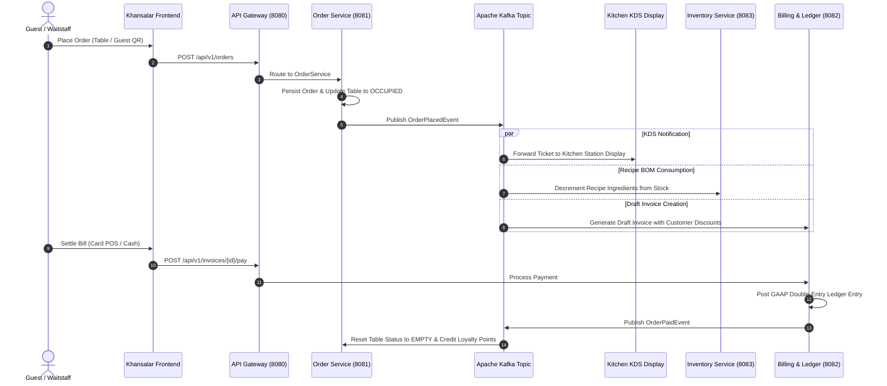

# Khansalar (خوان‌سالار) Enterprise Restaurant & Cafe ERP & POS System

> A high-performance, non-blocking reactive ERP, POS, and financial accounting platform designed for high-end dining, traditional luxury restaurants, and modern hospitality chains.

[](https://www.oracle.com/java/)
[](https://spring.io/projects/spring-boot)
[](https://spring.io/projects/spring-framework)
[](https://kafka.apache.org/)
[](https://r2dbc.io/)
[](https://redis.io/)
[](https://react.dev/)
[](https://tailwindcss.com/)

---

## 🏛️ Architecture & Technology Stack

Khansalar is engineered using enterprise non-blocking reactive patterns, asynchronous event-driven messaging, and resilient microservices architecture:

* **Core Platform & Language:** Java 21 LTS + Spring Boot 3.3.4
* **Reactive Engine:** Spring WebFlux + Project Reactor (fully non-blocking I/O)
* **API Gateway & Routing:** Spring Cloud Gateway (reactive routing, JWT authentication, unified CORS)
* **Security & Auth:** Spring Security Reactive + Stateless HMAC-SHA256 JWT
* **Event Broker:** Apache Kafka (KRaft mode, decoupled pub/sub event pipeline)
* **Reactive Database:** PostgreSQL 16 + Spring Data R2DBC
* **Distributed Cache & Locking:** Redis Reactive (Lettuce driver)
* **Frontend Application:** React 19 + TypeScript + Vite + Tailwind CSS + Lucide Icons + Synthesized Web Audio API sound effects

---

## 📦 Multi-Module Project Structure

```
khansalar/
├── docker-compose.yml                  # Infrastructure: Kafka (KRaft), Redis, PostgreSQL
├── README.md                           # Master project documentation
│
├── khansalar-backend/                  # Multi-module Maven backend parent
│   ├── pom.xml
│   ├── khansalar-common/               # Shared DTOs, Kafka event contracts, domain enums
│   ├── khansalar-gateway/              # Port 8080 - API Gateway, reactive JWT security, global routing
│   ├── khansalar-order-service/        # Port 8081 - POS orders, tables, KDS, CRM, reservations, guest QR
│   ├── khansalar-billing-service/      # Port 8082 - Invoicing, double-entry ledger, BI analytics & BCG matrix
│   └── khansalar-inventory-service/    # Port 8083 - Warehouse inventory, recipe BOM, Kafka auto-deduction
│
└── khansalar-frontend/                 # Modern React 19 + TypeScript SPA
    ├── src/
    │   ├── components/                 # Floor plan, POS, Invoices, KDS, BOM, CRM, Ledger, Reservations, BI
    │   ├── services/                   # Unified API client with offline localStorage fallback
    │   ├── types/                      # Comprehensive TypeScript ERP type definitions
    │   └── utils/                      # Persian typography, Jalali calendar, Web Audio SFX
```

---

## 🌟 Key Enterprise Features

### 1. Digital Menu & QR Code Self-Ordering (Guest Experience)
* **Table QR Stands:** High-contrast printable QR stand for each dining table with authentic Persian styling.
* **Smartphone Simulator:** Complete mobile browser guest experience allowing customers to view the digital menu, photos, descriptions, and dietary notes.
* **Direct Kitchen Dispatch:** Guests submit orders directly from their phones, automatically forwarding tickets to the kitchen display system (KDS) and triggering inventory recipe deductions.
* **One-Click Waiter Calling:** Instant table alerts for bill requests, extra cutlery, water/beverage refills, or table cleaning.

### 2. Advanced Reservations & VIP Event Management (F8)
* **Occasion Tagging:** Dedicated configurations for **VIP Royal Banquets**, **Birthdays**, **Business Dinners**, **Anniversaries**, and **General Dining**.
* **Deposit Tracking:** Tracks advance deposits and confirmation states (`PENDING`, `CONFIRMED`, `SEATED`, `CANCELLED`, `NO_SHOW`).
* **Table Synchronization:** Automatically transitions assigned tables from `EMPTY` to `RESERVED`, then to `OCCUPIED` upon guest arrival, and back to `EMPTY` upon checkout or cancellation.

### 3. Executive Business Intelligence (BI) & Menu Engineering (F9)
* **Boston Consulting Group (BCG) / Kasavana & Smith Matrix:**
  * ⭐ **Stars:** High Popularity + High Margin *(Preserve recipe consistency, prioritize in digital menu view)*
  * 🐴 **Plowhorses:** High Popularity + Low/Moderate Margin *(Optimize food costs or adjust portion pricing)*
  * 🧩 **Puzzles:** Low Popularity + High Margin *(Upsell via waitstaff, feature in promotional campaigns)*
  * 🐕 **Dogs:** Low Popularity + Low Margin *(Phase out or replace with seasonal specials)*
* **Financial KPIs:** Real-time Gross Revenue, Gross Profit, Average Order Value (AOV), and Food Cost % benchmarking.
* **Hourly Sales Peak Heatmap:** Visualizes dining traffic patterns across lunch (12:00–15:00) and dinner (19:00–23:00) peaks.
* **Category Contribution:** Revenue distribution across royal main courses, traditional syrups, appetizers, and desserts.

### 4. Interactive Floor Plan & Live Table Management (F1)
* **Zone Organization:** Separate visual zones for VIP Royal Booths (شاه‌نشین), Garden Fountain Lounges (آب‌نما), and the Main Dining Hall.
* **Live Occupancy Tracking:** Displays active seating duration timers, table capacities, and real-time open balances.
* **Persian Cultural Motifs:** Each table is adorned with authentic cultural symbols (Boteh Jegheh, Shah Abbasi lotus, Saffron flower, and Pomegranate).

### 5. High-Speed Cashier POS (F2)
* **Rapid Order Entry:** Fast category switching, modifier notes, customer search, and quantity incrementation.
* **VIP Club Discounting:** Automatic calculation of tier-based discounts based on customer membership.

### 6. Billing, Invoicing & Split-Bill Calculator (F3)
* **Payment Methods:** Support for Card POS, Cash, and Online gateways.
* **Split Bill (دانگ‌شمار):** Built-in calculator for splitting checks evenly or by customized shares among dining parties.
* **Thermal Receipt Printing:** Formatted thermal receipts complete with authentic Khatam-style Persian seals.

### 7. Kitchen Display System - KDS (F4)
* **Multi-Station Filtering:** Real-time ticket dispatching to Grill (منقل), Hot Kitchen, Traditional Syrups & Bar (شربت‌خانه), and Desserts.
* **Elapsed Time Monitor:** Priority color coding and audio chimes for VIP and urgent orders.

### 8. Warehouse Inventory & Recipe Bill of Materials - BOM (F5)
* **Kafka-Driven Depletion:** Placing an order emits an `OrderPlacedEvent` that automatically decrements raw ingredient quantities based on the dish's recipe BOM.
* **Reorder Thresholds:** Visual indicators and automated alerts for items reaching minimum inventory thresholds.
* **Procurement Logging:** Direct purchase order registration that automatically posts corresponding liability entries to the general ledger.

### 9. CRM & Loyalty Club (F6)
* **Four-Tier Loyalty System:** Bronze, Silver, Gold, and Royal Platinum tiers.
* **Customer Wallet & Points:** Earns 1 point per 10,000 Tomans spent; maintains credit balances and tracks visit history.

### 10. Double-Entry General Ledger & Daily Cashier Closing (F7)
* **GAAP-Compliant Accounting:** Automated double-entry bookkeeping (Assets, Liabilities, Equity, Revenue, Expense) for every settled invoice and inventory purchase.
* **Cashier Day Closing (Z-Report):** Generates official daily closing summaries reconciling Cash, POS card readers, sales tax, and total ticket counts.

---

## ⌨️ POS & ERP Keyboard Shortcuts

The entire desktop interface is optimized for cashier speed using standard functional hotkeys:

| Key | Tab / Module | Purpose |
| :---: | :--- | :--- |
| **F1** | Floor Plan (نقشه سالن) | Floor plan, table status, seating timers, and QR codes |
| **F2** | Order POS (سفارش‌گیری) | Rapid cashier order entry and cart management |
| **F3** | Invoices (فاکتور و تسویه) | Check settlement, payment processing, and split-bills |
| **F4** | Kitchen KDS (آشپزخانه) | Kitchen display system and station ticket fulfillment |
| **F5** | Inventory & BOM (انبارداری) | Raw material stocks, recipe BOM, and purchase logging |
| **F6** | Customers CRM (باشگاه مشتریان) | Loyalty tiers, customer profiles, and credit wallets |
| **F7** | General Ledger (دفتر کل مالی) | Double-entry accounting ledger and daily closing |
| **F8** | **Reservations (رزرواسیون)** | **VIP bookings, event management, and deposit records** |
| **F9** | **Executive BI (هوش تجاری)** | **BCG menu engineering matrix and hourly peak analytics** |

---

## 🚀 Quick Start Guide

### Prerequisites
* **Docker & Docker Compose** (for Kafka, Redis, and PostgreSQL)
* **Java Development Kit (JDK 21 LTS)**
* **Apache Maven 3.9+**
* **Node.js 18+ & npm**

---

### Step 1: Start Infrastructure Containers

From the repository root directory:
```bash
docker-compose up -d
```

This initializes:
* **PostgreSQL 16:** Available on `localhost:5432` (`khansalar_db`)
* **Redis:** Available on `localhost:6379`
* **Apache Kafka (KRaft):** Available on `localhost:9092`

---

### Step 2: Build the Backend

```bash
cd khansalar-backend
mvn clean install -DskipTests
```

---

### Step 3: Run the Microservices

You can start each service in separate terminals or through your favorite IDE:

1. **API Gateway (Port 8080):**
   ```bash
   cd khansalar-gateway
   mvn spring-boot:run
   ```

2. **Order Service (Port 8081):**
   ```bash
   cd khansalar-order-service
   mvn spring-boot:run
   ```

3. **Billing & Accounting Service (Port 8082):**
   ```bash
   cd khansalar-billing-service
   mvn spring-boot:run
   ```

4. **Inventory & BOM Service (Port 8083):**
   ```bash
   cd khansalar-inventory-service
   mvn spring-boot:run
   ```

---

### Step 4: Run the Frontend Application

```bash
cd khansalar-frontend
npm install
npm run dev
```

Open your browser and navigate to:
```
http://localhost:5173
```

---

## 🔐 Default Authentication Credentials

Login endpoint: `POST http://localhost:8080/api/v1/auth/login`

| Role | Username | Password | Access Scope |
| :--- | :--- | :--- | :--- |
| **Administrator / Owner** | `admin` | `admin123` | Full access to all ERP, BI, Financial, and Management modules |
| **Cashier / Accountant** | `cashier` | `123456` | POS orders, invoicing, payments, customer club, and ledger |
| **Waitstaff / Host** | `waiter` | `123456` | Floor plan, order taking, table status, and reservations |

---

## 🔄 Event-Driven Architecture & Message Flow



---

## 🎨 Cultural Design System & Aesthetics

Khansalar's frontend pays homage to classical Persian architecture, miniature arts, and Iranian hospitality traditions:
* **Persian Royal Palette:** Lapis Lazuli Deep Navy (`#050e1f`), Neyshabur Turquoise (`#00c8b3`), and Safavid Imperial Gold (`#e5b869`).
* **Geometric & Floriated Ornaments:** Pure SVG renderings of **Shamseh 8-pointed stars**, **Toranj medallions**, and Safavid **Shah Abbasi lotus flowers**.
* **Persian Typography:** Native support for Vazirmatn font, Persian numbers (`۱۲۳۴۵۶۷۸۹۰`), and Jalali (Solar Hijri) solar calendar dates and times.
* **Ergonomic Sound Design:** Real-time synthesized micro-tones using the browser's native Web Audio API (gentle clicks, coin chime for checkout, harmonized cart bells, and kitchen alerts).

---

## 📄 License

This project is developed under the [MIT License](LICENSE).
All rights reserved © 2026 Khansalar Restaurant Management Solutions.
